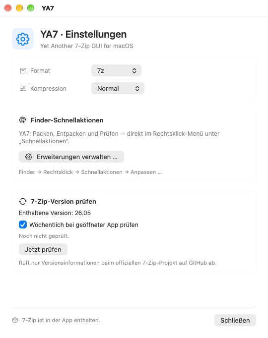

<p align="center"></p>

# YA7

**Yet Another 7-Zip GUI for macOS**

A native SwiftUI/AppKit archive utility with a bundled 7-Zip engine and Finder Quick Actions. macOS 14 or later; Universal builds for Apple Silicon and Intel. No Homebrew installation required to use the app.

[Deutsch](docs/README.de.md) · [Releases](https://github.com/BenThrottle85/YA7/releases) · [Changelog](CHANGELOG.md) · [License](LICENSING.md)

## Install

Download the notarized DMG from [GitHub Releases](https://github.com/BenThrottle85/YA7/releases), open it and drag **YA7.app** to **Applications**. Quit a running copy before replacing it, then launch YA7 from Applications. macOS may ask you to confirm the first launch.

In Finder, enable **YA7: Packen**, **YA7: Entpacken** and **YA7: Prüfen** under **Quick Actions → Customize**. Choose **Fertig** after a successful action so Finder can import the result. The app currently uses a German interface.

## Features

| Operation | Formats |
|---|---|
| Create | 7z, ZIP, TAR, TAR.GZ, TAR.BZ2, TAR.XZ |
| Read/extract | 7z, ZIP, RAR, TAR, GZIP, BZIP2, XZ, Zstandard, CAB, ISO, DMG |

- Browse archive contents and extract selected entries.
- Process compressed TAR archives in one operation, including tgz, tbz, tbz2, txz and tzst aliases.
- Create password-protected ZIP/7z archives. ZIP passwords use printable ASCII; 7z supports Unicode.
- Check archive integrity where supported by the format and engine.
- Preserve existing output files and reject unsafe extraction paths and symbolic/hard links.
- Manually check for a new 7-Zip version, or enable the weekly check while YA7 is running. See [privacy](docs/PRIVACY.md).

The bundled engine is **7-Zip 26.05**. Version checks report upstream releases; they do not download or replace the engine. Engine updates ship in a new signed YA7 release.

## Screenshots

<picture><source media="(prefers-color-scheme: dark)" srcset="docs/images/settings-dark.png"></picture>

## Build and test

Install Xcode with the macOS SDK, select its command-line tools and accept its license. Open `YA7.xcodeproj`, choose the **YA7** scheme and run/build for **My Mac**. No third-party package manager is required. The official engine and corresponding source archive are included.

```sh
# Local ad-hoc Universal build; does not install or upload the app.
YA7_BUILD_ROOT="$PWD/.build/xcode" sh build-app.sh "$PWD/dist/YA7.app"

# Existing Xcode app-host tests; use an unlocked graphical macOS session.
xcodebuild -project YA7.xcodeproj -scheme YA7 \
  -destination 'platform=macOS' -derivedDataPath .build/tests \
  CODE_SIGN_IDENTITY=- OTHER_CODE_SIGN_FLAGS=--timestamp=none test
```

Local builds are not notarized. See [release instructions](docs/RELEASING.md) and [notarization](NOTARISIERUNG.md) for Developer-ID distribution. Regenerate the committed project and Finder type declarations with `python3 Scripts/generate-project.py` only when source/catalog membership changes.

## Status and limitations

YA7 is an early release. Version 0.2.7 passed 18 local Xcode tests, a Universal release build and Apple notarization. This is not a claim of exhaustive compatibility or a security audit. GitHub Actions is configured only for standard macOS runners in this public repository, which are currently free under GitHub's public-repository rules. Jobs skip private repositories. No larger runners, artifact/cache uploads or paid add-ons are configured. The first hosted CI run is pending publication. See [GitHub Actions billing](https://docs.github.com/en/billing/concepts/product-billing/github-actions).

Intel/macOS 14 runtime testing, a fresh installation on a second Mac and a repeat of the latest features through Finder's actual context menu remain outstanding. Native Finder configuration views and selection validation were checked separately.

No editing existing archives, multipart archives, arbitrary recursive nested archives, encrypted filenames or Finder double-click association yet. ISO/DMG images are read as archives rather than mounted; some variants/encryption methods are unsupported. Progress is currently indeterminate. Files containing links are rejected on extraction.

Known follow-ups: overlapping archive reads may publish stale navigation results; successful Finder outputs remain temporarily available for the host to import, with their cleanup lifecycle still to be improved.

## License and attribution

YA7's own source code is **LGPL-2.1-or-later**. [LICENSING.md](LICENSING.md) defines its scope and third-party exceptions. 7-Zip by Igor Pavlov retains its LGPL/BSD/unRAR terms; original notices and matching source are included. Apple-provided interface symbols retain Apple's terms. YA7 is an independent interface, not an official 7-Zip or Apple product.
