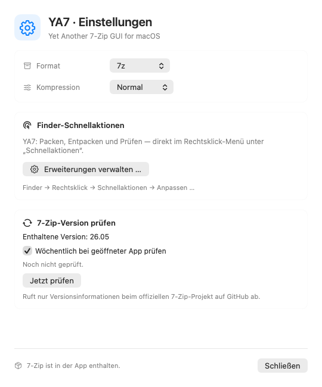

# YA7 - Yet Another 7-Zip GUI for macOS

Version **0.2.9 (Build 11)**. Native macOS-App ab macOS 14, Universal-Build fuer Apple Silicon und Intel. Enthalten: offizielles 7-Zip 26.05 und drei Finder-Schnellaktionen. Kein Homebrew erforderlich.

## Sprachen

YA7 unterstützt **Deutsch und Englisch**. Die Sprache folgt den macOS-App-Einstellungen; Englisch ist die Rückfallsprache. Für eine abweichende App-Sprache: **Systemeinstellungen → Allgemein → Sprache & Region → Programme**, YA7 hinzufügen und Deutsch oder Englisch wählen, anschließend YA7 neu starten. Finder-Erweiterungen folgen der System-/Finder-Sprache. Eigene Datei- und Archivnamen bleiben unverändert.

## Archivformate

- Erstellen: **7z, ZIP, TAR, TAR.GZ, TAR.BZ2, TAR.XZ**.
- Lesen/Entpacken: **7z, ZIP, RAR, TAR, GZIP, BZIP2, XZ, Zstandard, CAB, ISO, DMG**.
- Aliase: **tgz, tbz, tbz2, txz, tzst**; TAR.GZ/TAR.BZ2/TAR.XZ/TAR.ZST werden ueber beide Schichten verarbeitet.
- Komprimierte TAR-Archive koennen mehrere Dateien und Ordner enthalten. Die Auswahl einzelner Eintraege bezieht sich auf den inneren TAR-Inhalt.
- Passwortschutz beim Erstellen: ZIP/7z; TAR ohne Kompressionsstufe. Unpassende Erstelloptionen werden ausgeblendet. ZIP-Passwoerter verwenden druckbare ASCII-Zeichen, 7z erlaubt Unicode.
- ISO und DMG werden als Archive gelesen, nicht eingebunden. Nicht alle Image-Varianten/Verschluesselungen werden von 7-Zip unterstuetzt; Fehler werden angezeigt.
- Ein gemeinsamer Swift-Formatkatalog steuert Menues, Dateierkennung und Finder-Typregeln. Der Projektgenerator leitet Typdeklarationen daraus ab.

## 7-Zip-Version pruefen

In den Einstellungen stehen die enthaltene Engine-Version, das letzte erfolgreiche Ergebnis und **Jetzt pruefen** bereit. **Woechentlich bei geoeffneter App pruefen** ist standardmaessig aktiv und abschaltbar. Start, erneute Aktivierung und Aufwachen holen eine faellige Pruefung nach; kein separater Hintergrunddienst.

Quelle: `https://api.github.com/repos/ip7z/7zip/releases/latest`. Nur Versionsmetadaten werden abgefragt; keine Archivdaten. Numerischer Versionsvergleich, 15 Sekunden Netzwerkzeitlimit, zusammengefuehrte parallele Anfragen. Nach automatischen Fehlern wird fruehestens nach 24 Stunden erneut versucht; vorhandene erfolgreiche Ergebnisse bleiben erhalten. Manuelle Fehler erscheinen in den Einstellungen. Eine neue Version wird innerhalb der App mit Link zur offiziellen Veroeffentlichung angezeigt. Keine Systemmitteilungen oder automatische Installation. Engine-Aktualisierungen werden mit einer neuen signierten YA7-Version ausgeliefert.

Tests, Vorschau-/Demo-Renderings und Finder-Erweiterungen starten keine automatische Abfrage. Die enthaltene Versionsnummer stammt aus den mitgelieferten Hersteller-Metadaten.

## Installation und Finder

`YA7-0.2.9-macOS.dmg` oeffnen und YA7.app auf Programme ziehen. Eine vorhandene laufende YA7-App vor dem Austausch regulär schliessen. Danach aus Programme starten. Keine Testkopie aus einem Build-Ordner starten.

Finder: Rechtsklick -> Schnellaktionen -> Anpassen. **YA7: Packen**, **YA7: Entpacken**, **YA7: Pruefen** aktivieren. Bei Erfolg **Fertig** waehlen, damit Finder die Ausgaben uebernimmt. Die Haupt-App hat eine eigene Zielordnerauswahl. Keine automatische Installation oder oeffentliche Veroeffentlichung durch die Buildskripte.

## Sicherheit und Grenzen

Vorhandene Ausgaben werden nicht automatisch ueberschrieben. Komprimierte TAR-Stroeme werden in eigene temporaere Dateien geschrieben; Headernamen bestimmen keine Ausgabepfade. Alle inneren Entpackpfade werden geprueft, symbolische und harte Verknuepfungen abgelehnt. Zwischenarchive werden bei Erfolg, Fehler und Abbruch entfernt. Passwoerter werden ueber stdin uebergeben und nicht gespeichert.

Kein Bearbeiten bestehender Archive, keine Mehrteilarchive und keine beliebig rekursiven verschachtelten Archive. Verschluesselte Dateinamen werden weiterhin nicht geoeffnet. Fortschritt unbestimmt. Kein Finder-Doppelklick-Dateihandler und kein eigener Dateimanager fuer Umbenennen/Kopieren/Loeschen. Die bisherigen Bundle-Kennungen bleiben fuer Einstellungen und Finder-Identitaet erhalten.

Separat bekannte Punkte: ueberlappende Archiv-Leseauftraege koennten aeltere Ergebnisse einsetzen; erfolgreiche Finder-Ausgaben bleiben fuer die Uebernahme vorlaeufig im systemseitigen Austauschverzeichnis. Beide Punkte wurden hier nicht automatisch umgebaut.

## Entwicklung, Tests und Auslieferung

`YA7.xcodeproj` mit Schema YA7 oeffnen. `sh build-app.sh` baut alle Universal-Komponenten und exportiert die signierte App. Lokale Entwicklung bleibt mit Ad-hoc-Signierung moeglich. Das eingecheckte Xcode-Projekt benoetigt keine Drittanbieter-Generatoren; `python3 Scripts/generate-project.py` aktualisiert Quellen und Finder-Typregeln aus dem gemeinsamen Katalog. Der Generator benoetigt die installierten Xcode-Werkzeuge.

23 Xcode-Funktionstests bestanden: bisherige ZIP-/7z-Pruefungen, neue TAR-Roundtrips und Auswahl, Zielkonflikte, gefaehrliche innere Pfade, Abbruch, zusaetzliche CAB/ISO/DMG/Zstandard-Fixtures und netzwerkfreie Versions-/Intervall-/Fehlertests. Testbeispiele sind im Quellprojekt enthalten. Zusaetzlich eine echte Versionsabfrage gegen das offizielle Projekt erfolgreich.

Einstellungen hell/dunkel sowie die Finder-Konfigurationsansicht mit TAR.XZ visuell geprueft. Die separate native Finder-Ansichtsprobe ist kein Finder-Screenshot. Ein erneuter Live-Test ueber das echte Finder-Rechtsklick-Menue war mit den verfuegbaren Werkzeugen nicht moeglich. Intel und macOS 14 wurden kompiliert, nicht auf separaten Systemen ausgefuehrt. Frischer Download-/Installationstest auf einem zweiten Mac bleibt offen.

Developer-ID- und Notarisierungsablauf: [NOTARISIERUNG.md](../NOTARISIERUNG.md). Die 0.2.6-DMG bleibt als Rueckfallversion erhalten. Download und Release-Nachweise werden unter [GitHub Releases](https://github.com/BenThrottle85/YA7/releases) bereitgestellt.

## Lizenzen und Quellen

YA7 -> **Lizenzen und Quellcode ...** oeffnet die vollstaendigen LGPL-/Herstellerhinweise und das passende originale 7-Zip-Quellarchiv. Herkunft und SHA-256 stehen in `Vendor/7zip/Source-Provenance.json`. Das Vendor-Binary wurde nicht funktional geaendert; gebuendelte Kopien werden fuer macOS signiert.

7-Zip Copyright (C) 1999-2026 Igor Pavlov. LGPL-2.1-oder-spaeter, BSD und unRAR-Bedingungen gelten unveraendert. Der eigene YA7-Code steht unter LGPL-2.1-or-later; Einzelheiten und Ausnahmen stehen in [LICENSING.md](../LICENSING.md). Anbieterangaben und formale Namens-/Rechtepruefung sind getrennt zu beurteilen. Die selbst erzeugten Test-Fixtures enthalten ausschliesslich YA7-Beispieltext. Apples UI-Symbole sind nicht durch eine eigene YA7-Lizenz neu lizenziert. App-Icon: **Zip Seven**, separate blaue Sieben mit Reissverschluss, alle Standard-/Retina-Groessen.

Finder-Praxistest mit 0.2.9 erfolgreich: Nach Erstellen → Fertig erschien das 7z-Archiv neben der Originaldatei. Archivintegrität und identischer Inhalt wurden geprüft; die Finder-Klicks führte der Benutzer aus.
